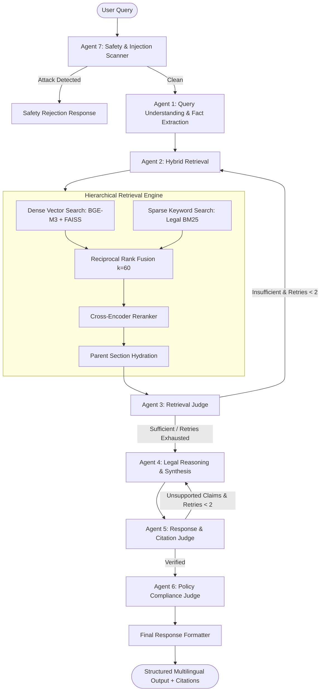

# LexIndica: Indian Legal AI Assistant — Architecture Guide

## 1. System Architecture Overview

LexIndica is an agentic, hierarchical Retrieval-Augmented Generation (RAG) platform tailored specifically for Indian tenancy and everyday civil law disputes. It addresses common failure modes of generic LLMs in legal tech: legal hallucination, fabricated section citations, jurisdictional confusion, and prompt injection vulnerabilities.

---

## 2. Structure-Aware Legal Chunking Hierarchy

Legal statutes possess an intrinsic structural hierarchy:
`Act → Chapter → Section → Subsection → Child Chunk`

### Parent-Child Contract:
1. **Section as Unit of Authority (Parent Document):**
   - The entire section (including all subsections, provisos, and explanations) is preserved intact as the parent document in `ParentSectionStore`.
   - Never truncated or fragmented across section boundaries.
2. **Child Chunks (~300–500 tokens):**
   - Long statutory sections are segmented into smaller dense retrieval units with 40–60 tokens of overlap *strictly within that section*.
   - Each child chunk explicitly carries:
     - `parent_section_id`
     - Exact `act_name`, `chapter`, `section_number`
     - Jurisdiction, State, Language, Source URL, and Official Authority metadata.
3. **Retrieval Expansion:**
   - When a child chunk is scored and selected during hybrid search, the retriever automatically fetches its **Parent Section** from the store. The LLM receives the full statutory context, eliminating context truncation errors.

---

## 3. Hybrid Retrieval & Reciprocal Rank Fusion (RRF)

### Dense Vector Retrieval:
- Multi-dimensional semantic embedding via `BAAI/bge-m3` indexed in a FAISS inner-product vector store (`IndexFlatIP`).
- Captures semantic intent across natural language descriptions in English, Hindi, and Hinglish.

### Sparse Legal BM25 Retrieval:
- Tokenizer preserves legal section syntax (`Section 10`, `Section 108(m)`, `MTA 2021`, `DRCA 1958`).
- Guarantees exact statutory keyword and precedent lookup without semantic drift.

### Reciprocal Rank Fusion (RRF):
$$RRF\_Score(d) = \sum_{m \in \{dense, sparse\}} \frac{1}{60 + Rank_m(d)}$$

Combined candidates are filtered by jurisdiction (e.g. Central vs. Delhi vs. Maharashtra) and reranked using a Cross-Encoder before parent hydration.

---

## 4. Multi-Agent Bounded Correction Loop

The orchestration is implemented using **LangGraph**:

| Agent | Responsibility | Output Artifact |
|---|---|---|
| **Agent 7: Safety Agent** | Scans for direct/indirect prompt injection, forgery, violence, utility cutoff | `SafetyCheckResult` |
| **Agent 1: Query Understanding** | Identifies legal domain, missing facts, jurisdiction, preferred language | `ExtractedFacts`, `retrieval_queries` |
| **Agent 2: Retrieval Agent** | Executes hybrid search, RRF, cross-encoder, parent section enrichment | `retrieved_evidence` |
| **Agent 3: Retrieval Judge** | Assesses sufficiency, relevance, coverage. Triggers query rewrite if insufficient | `retrieval_sufficient`, `retry_count` |
| **Agent 4: Legal Reasoning** | Synthesizes grounded explanation, applicable sections, practical remedies | `reasoning_draft`, `applicable_provisions` |
| **Agent 5: Response Judge** | Programmatically verifies citations against knowledge base; flags hallucinations | `response_approved`, `retry_count` |
| **Agent 6: Policy Compliance** | Enforces legal disclaimer, non-lawyer status, no extra-judicial advice | `policy_compliant` |
| **Final Formatter** | Generates clear response in English, Hindi, or Hinglish with follow-ups | `final_response` |

**Loop Bounding:** Both `retrieval_retry_count` and `response_retry_count` are strictly capped at `MAX_AGENT_CORRECTIONS = 2` to prevent infinite execution loops and redundant LLM billing. If evidence remains insufficient, the assistant gracefully abstains.

---

## 5. Security & Prompt Injection Defense

All user inputs and retrieved legal texts are treated as untrusted data:
1. **Delimited Data Wrapping:** User text is quarantined inside `<user_query>` tags accompanied by strict non-execution boundaries.
2. **Signature & Tag Escape Neutralization:** Regex heuristics neutralize `</system>`, `[instruction]`, and instruction-override phrases.
3. **Harmful Request Guardrails:** Explicitly blocks requests to forge legal documents (stamp papers, backdated receipts), fabricate evidence, or utilize physical violence/utility cutoffs.
